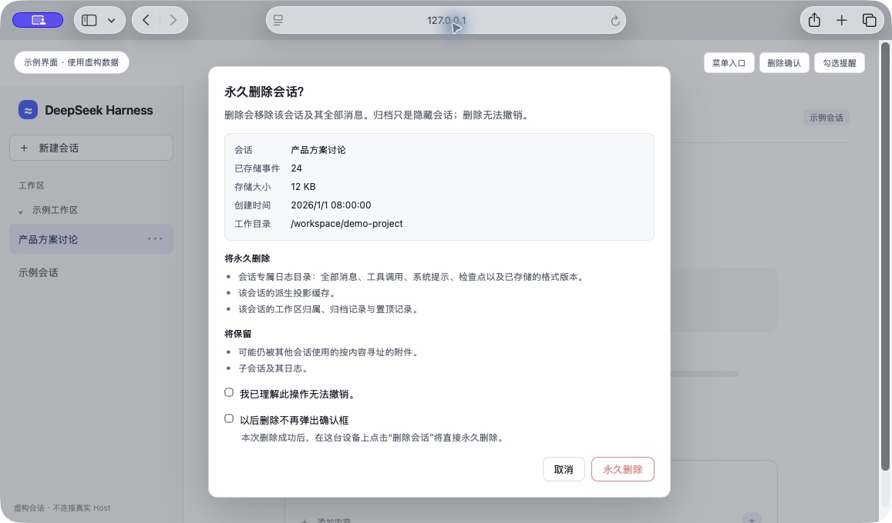
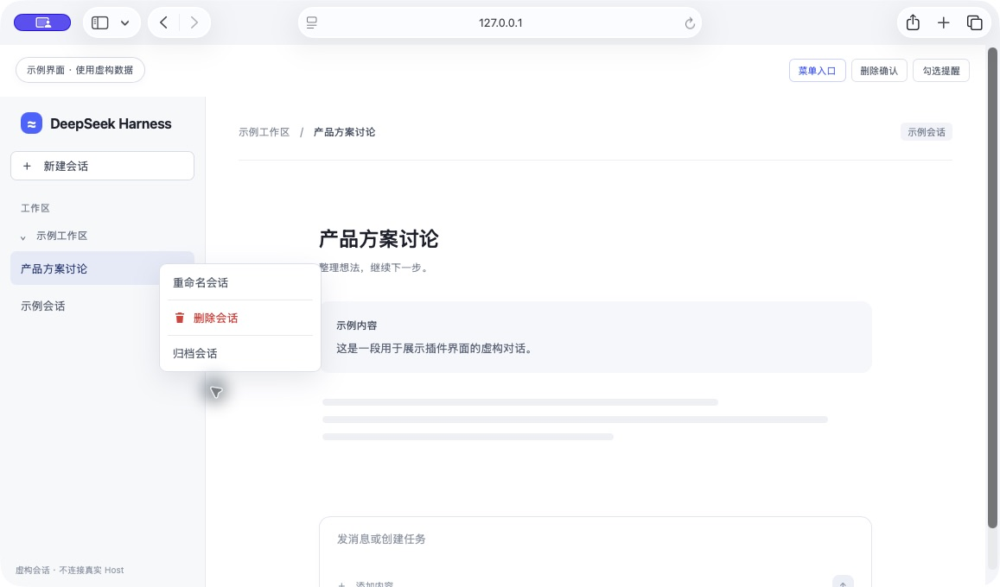

<div align="center">
  
  <h1>DeepSeek Harness · 删除会话</h1>
  <p>为会话菜单补上真正的删除能力：预览、确认、安全释放与可选的直接删除。</p>
  <p>
    
    
    
    
  </p>
  <p><a href="#界面预览">界面预览</a> · <a href="#安装与启用">安装</a> · <a href="#开始使用">使用</a> · <a href="docs/technical-details.md">技术说明</a> · <a href="dph-plugin-delete-session/README.en.md">English</a></p>
</div>

---

**归档用于隐藏，删除用于永久移除。** 插件在现有会话菜单中加入「删除会话」，保留内置归档功能。

| | 归档 | 删除会话 |
|---|---|---|
| 侧边栏 | 隐藏会话，可取消归档 | 移除会话 |
| 日志与消息 | 保留 | 永久删除 |
| 工作区关联 | 保留 | 移除所选会话的关联 |
| 归档与置顶 | 标记归档，并取消置顶 | 清理所选会话的记录 |
| 可恢复性 | 可以恢复 | 无法通过 Harness 恢复 |

> **删除无法撤销。** 会话消息、工具调用、检查点及派生投影缓存会被移除；项目文件、共享附件和子会话保留。

## 界面预览

<p align="center">
  
  <br>
  <sub>真实插件代码的独立预览 · 使用虚构会话数据，不包含真实账号、路径或对话内容。</sub>
</p>

<details>
<summary>查看侧边栏菜单入口</summary>

<p align="center">
  
  <br>
  <sub>会话菜单界面示例 · 由真实插件代码渲染，使用虚构会话数据。</sub>
</p>

</details>

## 功能

- **删除前预览**：查看标题、事件数量、日志大小、创建时间、工作目录与关联提示。
- **默认确认**：勾选「我已理解此操作无法撤销」后删除；未勾选时会提醒并聚焦确认项。
- **可选免确认**：勾选「以后删除不再弹出确认框」，在本次删除成功后保存偏好。
- **空闲会话直接处理**：即使已被 Agent 加载，也会先安全释放，再删除，无须切换会话或重启。
- **运行中保护**：运行中的回合、子代理、后台任务、计划任务或维护操作会阻止删除。
- **桌面与 Web**：支持桌面 `dsh-app://app/` 和本机 HTTP 页面，界面跟随 Harness 中英文设置。

## 安装与启用

插件包位于仓库的 **`dph-plugin-delete-session/` 子目录**，不是仓库根目录。无需构建或安装第三方运行时依赖。

### 1. 获取源码

```bash
git clone https://github.com/JustZhang823/deepSeek-harness-delete-session.git
```

例如，将仓库放在 `~/Projects/` 下。安装目标应为插件子目录的绝对路径：

| 系统 | Plugin Manager 的 `target` 示例 |
|---|---|
| macOS | `/Users/<用户名>/Projects/deepSeek-harness-delete-session/dph-plugin-delete-session` |
| Windows | `C:\Users\<用户名>\Projects\deepSeek-harness-delete-session\dph-plugin-delete-session` |

### 2. 安装插件包

在 Harness 中让 Plugin Manager 调用 `install_bundle`，`target` 填入你本机插件子目录的绝对路径。安装成功后，在 **插件 / Plugins** 页面启用 **删除会话 / Delete sessions**。

### 3. 重新加载页面

重新加载 Harness 页面以载入 Client。打开任一会话的右键或更多菜单，确认出现 **删除会话**。更新插件后也需要重新加载页面。

## 开始使用

1. 在侧边栏对目标会话打开右键或更多菜单，选择 **删除会话**。
2. 检查预览及关联提示。若会话仍在运行或维护中，先处理活动，再点 **重新检查**。
3. 勾选 **我已理解此操作无法撤销**，点击 **永久删除**。

成功后，会话从侧边栏移除。清理警告会说明需要进一步处理的项目。

### 以后不再弹出确认框

在确认对话框中勾选 **以后删除不再弹出确认框**。该选项默认关闭，只有本次已确认的删除成功后才会保存；取消或失败不会改变设置。

保存后，点击 **删除会话** 将直接提交永久删除，**不再打开确认或预览对话框**。成功显示短提示；错误和清理警告会持续显示，直到关闭。Host 的鉴权和运行状态检查仍然执行。

偏好保存在当前客户端/浏览器，刷新或重启后继续生效。需要重新确认时，在同一会话菜单中选择 **恢复删除确认提示**。若偏好保存失败，会明确提示；恢复操作即使保存失败，也立即在当前页面重新启用确认。

## 删除范围

| 会删除 | 会保留 |
|---|---|
| 所选会话的日志目录、全部消息和工具调用 | 项目目录及其中的文件 |
| 检查点、历史格式版本和派生投影缓存 | 可能被其他会话引用的共享附件 |
| 工作区归属、归档与置顶记录 | 子会话及其日志；指向已删除父会话的链接会缺失 |

## 兼容性与限制

- 仅支持 Harness 的 JSONL 会话存储布局；不受支持的布局、无法安全释放的 Agent 或写入权冲突会拒绝删除。
- 空闲 Agent 的释放适配当前 Cordis / AgentLoop 生命周期结构。运行时已卸载并不代表全部堆内存立即回收，具体说明见[生命周期限制](docs/technical-details.md#兼容性)。
- 已通过 **84 项测试**（含子测试），并检查桌面菜单与确认交互；未在验证过程中删除真实用户会话。
- macOS 桌面已验证；Windows 和深色主题尚未现场验证。

遇到 `ACTIVE`、授权错误或文件删除失败时，参阅[前置条件、错误码与恢复方式](docs/technical-details.md)。

## 项目结构

```text
.
├── README.md                     # 使用入口
├── docs/
│   ├── technical-details.md       # 前置条件、数据处理、授权与错误码
│   └── screenshots/              # README 界面图
└── dph-plugin-delete-session/    # Plugin Manager 安装目标
    ├── index.js                  # Host 删除服务与 HTTP 桥
    ├── client.js                 # 菜单、确认、偏好与反馈
    ├── agent-lifecycle.js         # 空闲 Agent 的安全释放
    └── test/                     # 回归测试
```

## 开发与许可

在插件目录使用兼容的 Node 运行时执行：

```bash
node --test test/*.test.mjs
```

代码采用 [MIT License](dph-plugin-delete-session/LICENSE)。
